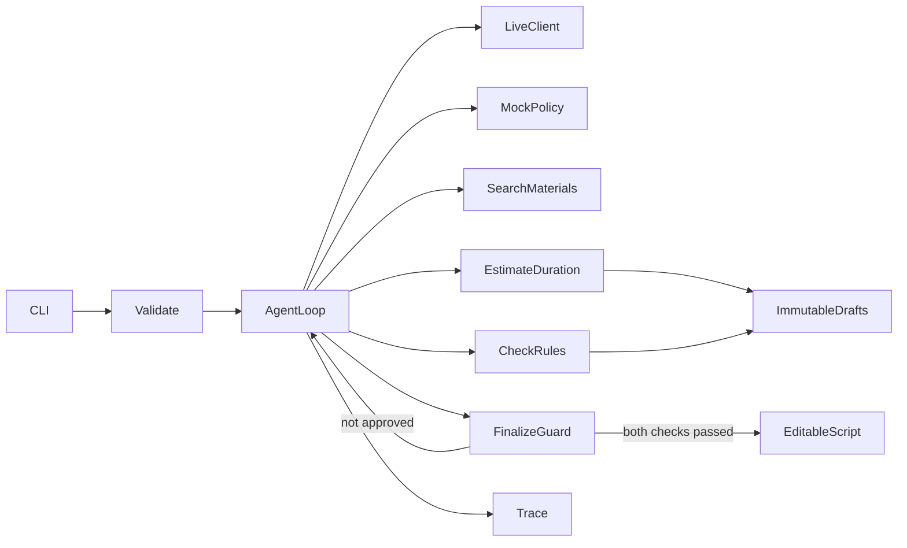

# 方案

Python标准库CLI/HTTP/JSON/hash，pytest验证。models结构校验与稳定哈希，tools素材状态/不可变草稿/两类确定性检查，policy最终核验，agent原生循环，llm_client真实模型选动作，mock_policy独立确定性策略。

每轮只接一个模型工具动作，执行后观察回填role=tool，模型据此修正或结束。两次模型错误或16轮/14工具上限返回incomplete，保留真实草稿和检查。finalize失败也反馈模型；不会把模型自由文本当作通过结果。Trace只含公开短理由，不含隐藏推理或密钥；next_action取自后续实际动作。

素材只通过search_materials进入已检索集合，规则校验要求素材/事实ID存在、已检索且与请求主题相关。字幕需与事实原文完整相等；旁白仅原文或中性品牌衔接语，标题/画面也受白名单约束。不能借视觉、标题等字段夹带80%效果断言。原文、版本及内容指纹由应用附加，不信任模型声明的引用。

estimate_duration用规范化JSON内容SHA-256登记深拷贝快照，同一内容同ID，任何修改产生新ID。时间为每镜hold/旁白/字幕/品牌最小值的max再加转场；不重复计算并行旁白字幕。check_rules读取同一ID，返回独立passed和风险。最终同时要求两项data.passed=true，ID相同，且context_hash与当前输入、素材、品牌一致，防止旧检查背书新脚本或新目标。

工具统一返回ok/data/error，ok表示操作执行成功，不表示脚本通过。故障在执行前显式注入；估时失败仍可保留已提交草稿，不能伪造检查结果。停止时返回缺口或风险，script为空、approved=false。最终输出只在completed时添加逐镜估时和来源注释；last_draft保留可编辑输入结构，draft_history保留失败候选及实际检查。

无Web UI/真实TTS/视频剪辑发布/多Agent/复杂RAG，避免扩大范围。输入initial_draft可用于复现实验性修订，不伪装成模型首稿。生成文本是受控表达，不能外推成通用自由文案事实判定能力。
